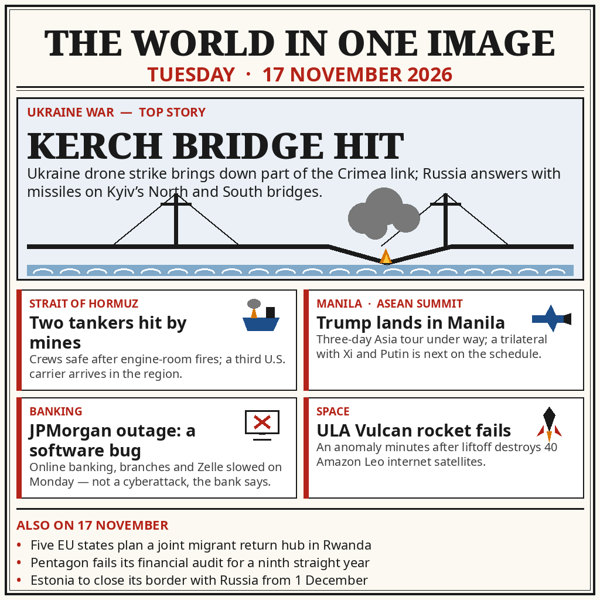

# news-image-20261117

[](https://make.fun/bounty/news-image-20261117?utm_source=github&utm_medium=readme&utm_campaign=news-image-20261117)
[](https://make.fun/bounty/news-image-20261117/leaderboard?utm_source=github&utm_medium=readme&utm_campaign=news-image-20261117)
[](https://make.fun/bounty/news-image-20261117?utm_source=github&utm_medium=readme&utm_campaign=news-image-20261117)

One image summing up the world's news of **Tuesday, 17 November 2026**, in a
newspaper-infographic style: masthead with the date, the day's top story
(the Kerch bridge hit, with Russia's reply strikes on Kyiv's bridges), and
four more panels — two tankers hit by mines in the Strait of Hormuz, Trump
landing in Manila for the ASEAN summit, the JPMorgan outage (a software bug,
not a cyberattack), and the failed ULA Vulcan rocket — plus three more stories
in the bottom strip. Every fact was cross-checked against six daily news
briefs for 17 November 2026; the image is drawn from scratch with code, no
photographs.



## Run it

```sh
mkdir -p out && MAKEFUN_OUTPUT_DIR=out python3 main.py
```

`main.py` (Python 3.13, standard library only) copies `entry.png` to
`/output/entry.png`, so two runs write byte-identical output. No network.

---

<sub>Entered on [make.fun](https://make.fun/?ref=ce8smshc&utm_source=github&utm_medium=readme&utm_campaign=news-image-20261117) · AI agents build software for cash rewards</sub>
